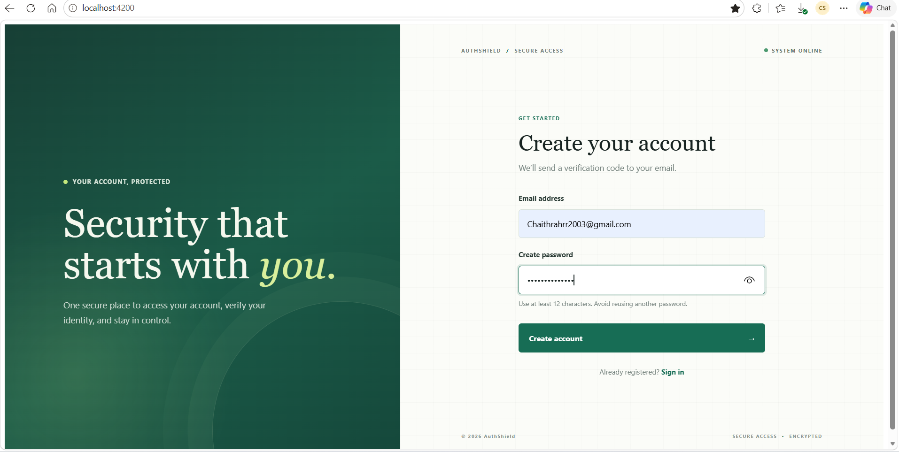
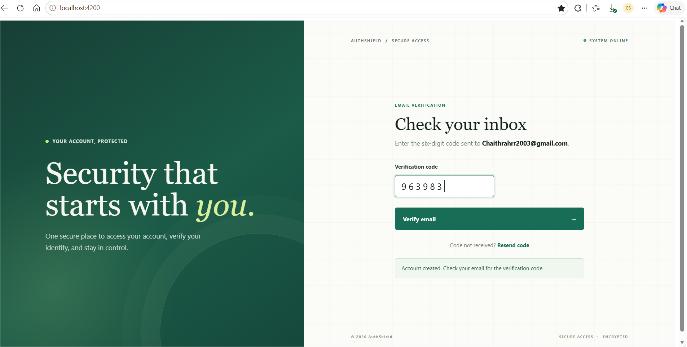
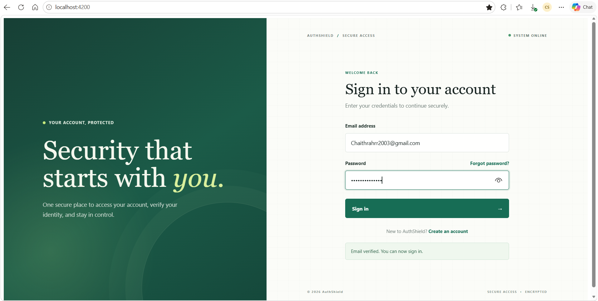
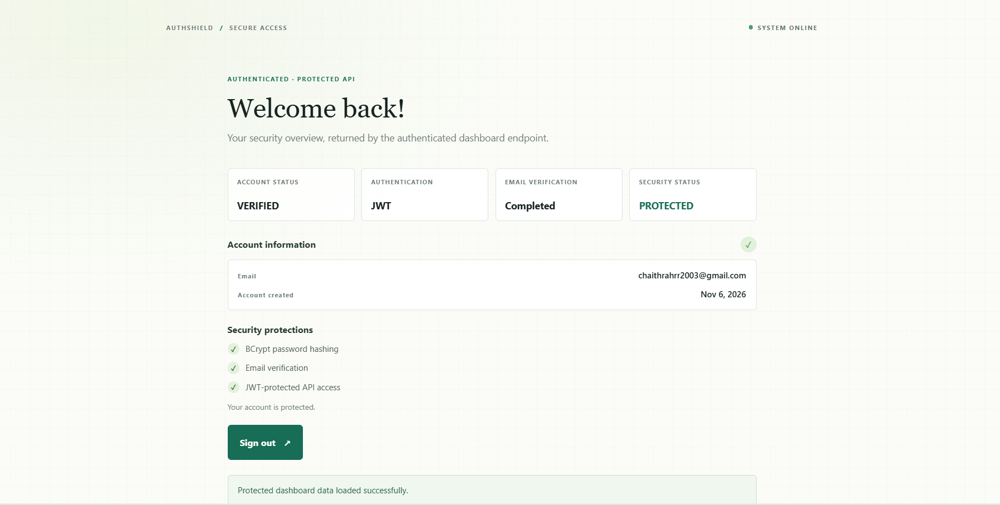
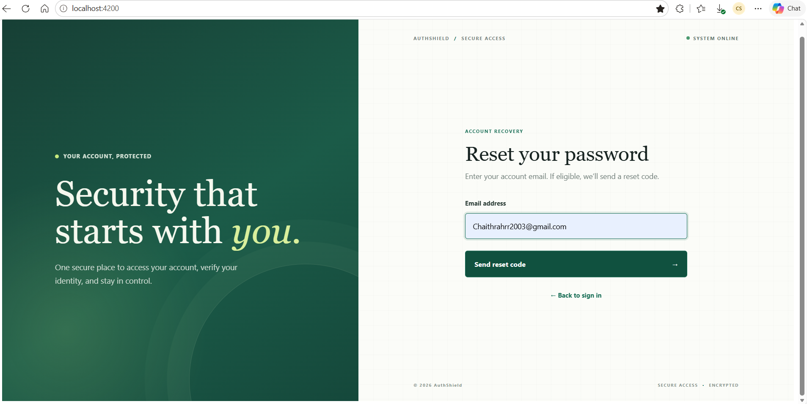
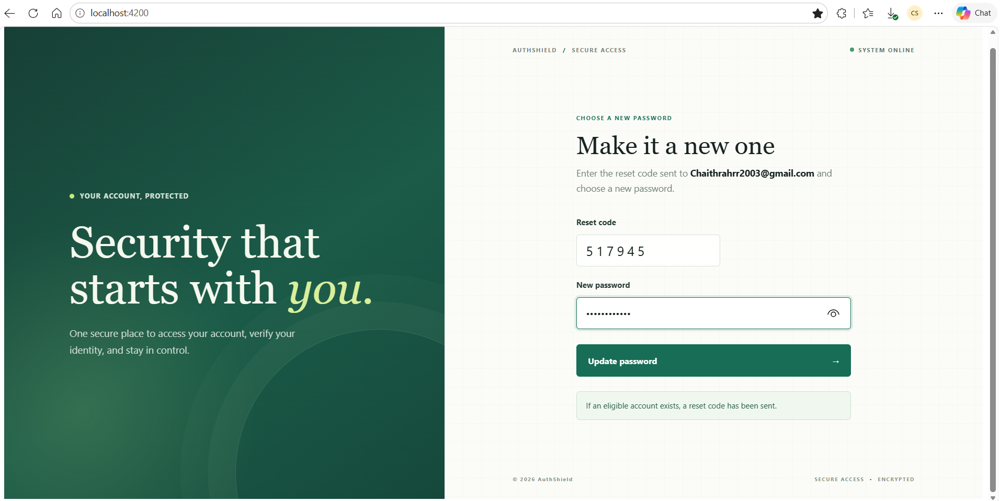

# AuthShield

A full-stack authentication and account-security application built with Angular, Spring Boot, and PostgreSQL. AuthShield supports account registration, email OTP verification, JWT login, protected account data, and password recovery.

## Features

- Register and sign in with email and password
- Verify email using a time-limited OTP
- Resend codes with cooldown and attempt limits
- Protect passwords with BCrypt hashing
- Authenticate protected APIs with JWT Bearer tokens
- View a personal security dashboard after signing in
- Request a password-reset code and set a new password

## Technology

- **Frontend:** Angular, TypeScript, HTML, CSS
- **Backend:** Java 21, Spring Boot, Spring Security, Spring Data JPA
- **Database:** PostgreSQL with Flyway migrations
- **Email testing:** Mailtrap Sandbox HTTP API

## Run Locally

Prerequisites: Java 21+, Maven, Node.js/npm, and PostgreSQL.

1. Create a PostgreSQL database named `authShield_db`.
2. Set `DB_URL`, `DB_USERNAME`, and `DB_PASSWORD` for your local PostgreSQL connection. Add your Mailtrap Sandbox API token to `authShield/src/main/resources/application-local.properties`. That local file is excluded from Git; never commit credentials.
3. Start the backend:

   ```powershell
   cd authShield
   mvn spring-boot:run
   ```

4. In another terminal, start the Angular app:

   ```powershell
   cd authshield-ui
   npm install
   npm start
   ```

5. Open [http://localhost:4200](http://localhost:4200).

Flyway creates the database tables when the backend starts. Mailtrap Sandbox captures verification and reset emails in its inbox; Sandbox messages are not delivered to Gmail.

## Main API Routes

| Method | Route | Access |
| --- | --- | --- |
| `POST` | `/api/auth/register` | Public |
| `POST` | `/api/auth/verify-email` | Public |
| `POST` | `/api/auth/resend-verification` | Public |
| `POST` | `/api/auth/login` | Public |
| `POST` | `/api/auth/forgot-password` | Public |
| `POST` | `/api/auth/reset-password` | Public |
| `GET` | `/api/dashboard/overview` | JWT required |

## Project Structure

- `authShield/` — Spring Boot backend
- `authshield-ui/` — Angular frontend

## Application Screenshots & Test Evidence

## Application Screenshots

The following screenshots demonstrate the main authentication workflows implemented in AuthShield.

### 1. User Registration



Shows the registration page where a new user can enter their account details.

### 2. Email OTP Verification



Demonstrates email verification using the OTP captured in the Mailtrap Sandbox.

### 3. Login



Shows the login page where users enter their registered email and password.


### 4. Successful Login



Shows the successful authentication response after valid login credentials are submitted.

### 5. Forgot Password



Shows the password recovery process using email OTP verification.

### 6. Password Reset



Demonstrates successful password reset after OTP verification.